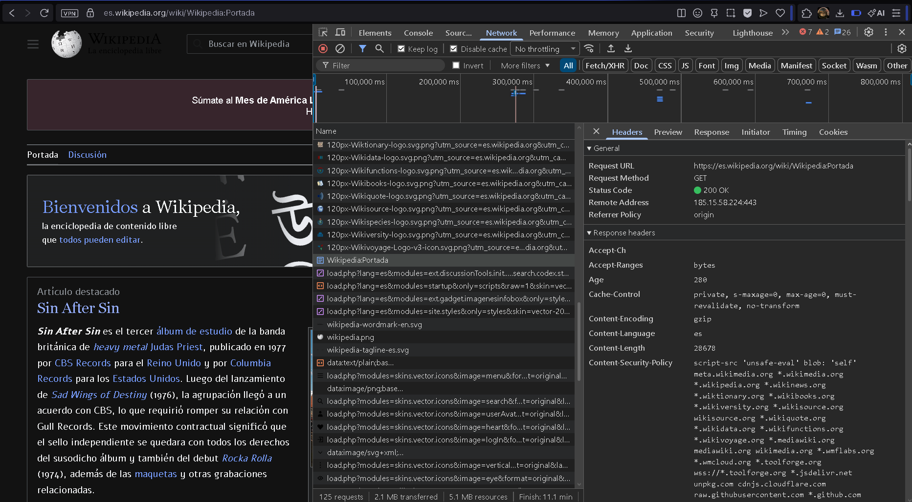
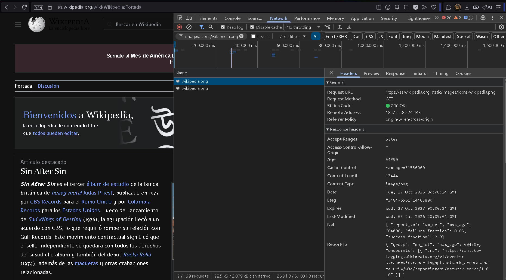
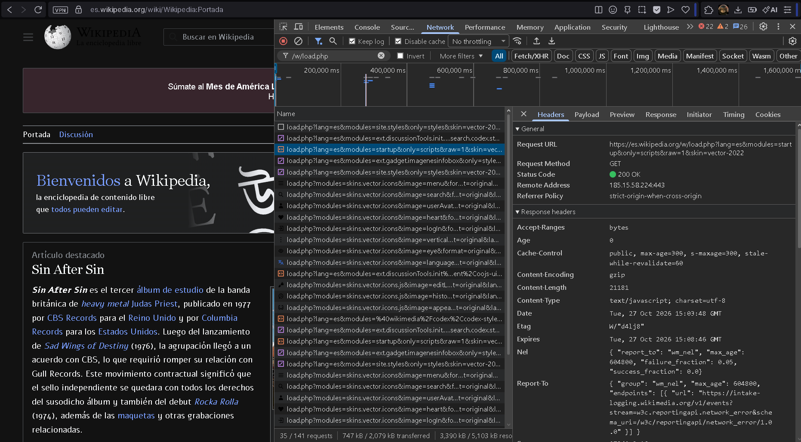

# Wikipedia

Web elegida: [wikipedia](https://es.wikipedia.org/wiki/Wikipedia:Portada)

## Frontend

El frontend es la parte que vemos y usamos en el navegador.
Incluye las páginas de Wikipedia y sus botones.
También incluye los textos y los enlaces.

## Backend

El backend funciona en los servidores de Wikipedia.
Busca y guarda los artículos.
También procesa las acciones de las personas que usan la web.

## Modelo cliente-servidor

El navegador es el cliente.
Cuando abrimos un artículo el navegador pide esa página al servidor.
El servidor busca la información y la envía al navegador.
El navegador muestra la página en la pantalla.

Cuando editamos un artículo el navegador envía los cambios al servidor.
El servidor los procesa y guarda la nueva versión.

## Captura de Network

1. `Portada` — Estado `200`. Content-Type `text/html; charset=UTF-8`. Pide el documento de la portada `metodo de envio:` GET.

2. `wikipedia.png` — Estado `200`. Content-Type `image/png`. Pide el icono de Wikipedia `Metodo de envio` GET.

3. `load.php` — Estado `200`. Content-Type `text/javascript; charset=utf-8`. Pide los estilos de la página `Metodo de envio` GET.
